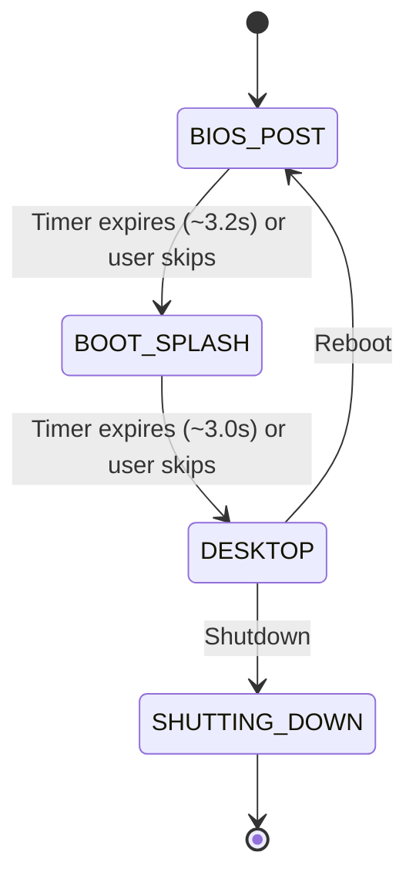

# CSOPESY OS Mockup — Project Handoff

## 1. What This Project Is

A self-contained desktop operating system emulator built for the CSOPESY (Operating Systems Engineering) course. It boots through a retro BIOS POST screen, transitions through an animated splash, and lands on an interactive windowed desktop — all rendered in real time with **OpenGL 3.3**, **GLFW**, and **Dear ImGui**. Nothing hits the real filesystem or OS; every process, file, and terminal command is simulated in memory.

---

## 2. Tech Stack

| Layer | Technology | Version / Notes |
|---|---|---|
| Language | C++17 | Compiled with MSVC (Visual Studio 2019/2022) |
| Graphics API | OpenGL 3.3 Core Profile | Via GLAD loader bundled in `external/glad/` |
| Windowing | GLFW | v3.4 — fetched automatically by CMake `FetchContent` |
| UI Framework | Dear ImGui | v1.91.8 — also fetched via `FetchContent` |
| Build System | CMake | v3.20+ required |

All dependencies are either fetched at build time or vendored in the repo. No package manager or manual install needed.

---

## 3. Repository Layout

```
os-mockup/
├── CMakeLists.txt              ← Single-file build config, fetches GLFW + ImGui
├── README.md                   ← Public-facing docs (build instructions, features)
├── .gitignore
├── imgui.ini                   ← ImGui window layout persistence
├── external/glad/              ← Vendored OpenGL 3.3 Core loader
│   ├── include/{glad/,KHR/}
│   └── src/glad.c
└── src/
    ├── Main.cpp                ← Entry point, GLFW/OpenGL/ImGui init, main loop
    ├── Core/
    │   ├── Types.h             ← Shared enums and data structs (BootState, ProcessInfo, VirtualFile, TerminalLine)
    │   ├── SystemContext.h     ← Central state object declaration
    │   └── SystemContext.cpp   ← State machine, process sim, VFS tree, terminal command interpreter
    ├── Boot/
    │   ├── BootScreens.h
    │   └── BootScreens.cpp     ← BIOS POST and boot splash rendering
    ├── Desktop/
    │   ├── DesktopBackground.h
    │   ├── DesktopBackground.cpp  ← Wallpaper gradient, desktop icons, clock widget, PWR dialog
    │   ├── Taskbar.h
    │   └── Taskbar.cpp         ← Bottom dock: Start menu, app toggles, system tray
    ├── Apps/
    │   ├── TaskManagerWindow.{h,cpp}   ← Processes tab, Performance graphs, System summary
    │   ├── FileExplorerWindow.{h,cpp}  ← Tree nav + file list table, opens files in Notepad
    │   ├── TerminalWindow.{h,cpp}      ← Retro shell with history recall
    │   ├── SystemInfoWindow.{h,cpp}    ← OpenGL introspection, FPS, theme switcher
    │   └── NotepadWindow.{h,cpp}       ← Multiline text viewer/editor
    └── Compositor/
        ├── WindowCompositor.h
        └── WindowCompositor.cpp  ← Orchestrates render order + keyboard shortcuts
```

---

## 4. Architecture — How It All Fits Together

### 4.1 State Machine

The application runs a linear boot pipeline managed by [`SystemContext`](file:///c:/Users/Duncan Joseph/Desktop/Repositories/os-mockup/src/Core/SystemContext.h):



The [`BootState`](file:///c:/Users/Duncan Joseph/Desktop/Repositories/os-mockup/src/Core/Types.h#L10-L15) enum defines the four states. [`Main.cpp`](file:///c:/Users/Duncan Joseph/Desktop/Repositories/os-mockup/src/Main.cpp#L108-L116) switches on the current state each frame and delegates to the appropriate renderer.

### 4.2 The `SystemContext` — Single Source of Truth

[`SystemContext`](file:///c:/Users/Duncan Joseph/Desktop/Repositories/os-mockup/src/Core/SystemContext.h#L11-L128) is the god object. It owns:

| Subsystem | What It Manages |
|---|---|
| **State machine** | Current `BootState`, timers, reboot/shutdown |
| **Process table** | `vector<ProcessInfo>` with jittered CPU/memory stats, kill/spawn |
| **Performance history** | Rolling 60-sample arrays for CPU and RAM (drives Task Manager graphs) |
| **Virtual File System** | In-memory tree of `VirtualFile` nodes rooted at `C:\` |
| **Terminal** | Command history, output buffer, command interpreter |
| **Notepad** | Active file title + text buffer |
| **Window visibility** | `bool` flags for every window and popup |
| **Theme** | Current `ThemeMode` enum value |

Every UI module receives a `SystemContext&` reference — no globals, no singletons.

### 4.3 Render Pipeline (per frame)

[`Main.cpp`](file:///c:/Users/Duncan Joseph/Desktop/Repositories/os-mockup/src/Main.cpp#L86-L128) runs this loop:

1. `glfwPollEvents()`
2. Calculate `deltaTime`
3. `sysContext.update(deltaTime)` — advances timers, jitters process stats, rolls history
4. Start ImGui frame
5. **State dispatch:**
   - `BIOS_POST` → [`BootScreens::renderBiosPost()`](file:///c:/Users/Duncan Joseph/Desktop/Repositories/os-mockup/src/Boot/BootScreens.cpp#L8-L108)
   - `BOOT_SPLASH` → [`BootScreens::renderBootSplash()`](file:///c:/Users/Duncan Joseph/Desktop/Repositories/os-mockup/src/Boot/BootScreens.cpp#L110-L227)
   - `DESKTOP` → [`WindowCompositor::render()`](file:///c:/Users/Duncan Joseph/Desktop/Repositories/os-mockup/src/Compositor/WindowCompositor.cpp#L13-L28)
6. `ImGui::Render()` → `glClear` → `ImGui_ImplOpenGL3_RenderDrawData` → `glfwSwapBuffers`

### 4.4 Desktop Compositor Layer Order

[`WindowCompositor::render()`](file:///c:/Users/Duncan Joseph/Desktop/Repositories/os-mockup/src/Compositor/WindowCompositor.cpp#L13-L28) draws in this order (back to front):

1. **Layer 1 — Desktop Background**: wallpaper gradient, grid overlay, shortcut icons, clock widget, PWR button, shutdown modal
2. **Layer 2 — Application Windows** (movable, focusable): Task Manager → File Explorer → Terminal → System Info → Notepad
3. **Layer 3 — Taskbar Dock**: Start menu, app toggle buttons, system tray (volume, network, clock, PWR)

Keyboard shortcuts are handled in [`WindowCompositor::handleShortcuts()`](file:///c:/Users/Duncan Joseph/Desktop/Repositories/os-mockup/src/Compositor/WindowCompositor.cpp#L30-L52).

---

## 5. Key Data Structures

All defined in [`Types.h`](file:///c:/Users/Duncan Joseph/Desktop/Repositories/os-mockup/src/Core/Types.h):

| Struct | Purpose |
|---|---|
| `ProcessInfo` | PID, name, CPU/memory stats, system-protected flag |
| `VirtualFile` | Recursive tree node (name, isDirectory, children, content) |
| `TerminalLine` | Single line of terminal output with color and isCommand flag |

---

## 6. Theme System

Four themes defined in [`ThemeMode`](file:///c:/Users/Duncan Joseph/Desktop/Repositories/os-mockup/src/Core/Types.h#L17-L22):

| Theme | Visual |
|---|---|
| `CYBER_DARK` | Modern slate + cyan accents, subtle grid wallpaper |
| `CLASSIC_98` | Windows 98 teal desktop, gray ImGui chrome |
| `RETRO_AMBER` | Monochrome CRT amber phosphor |
| `MATRIX_GREEN` | Green-on-black cyberpunk |

Themes affect two things independently:
- **Desktop wallpaper** — handled in [`DesktopBackground::render()`](file:///c:/Users/Duncan Joseph/Desktop/Repositories/os-mockup/src/Desktop/DesktopBackground.cpp#L33-L69)
- **ImGui widget colors** — applied by [`SystemInfoWindow::applyThemeToImGui()`](file:///c:/Users/Duncan Joseph/Desktop/Repositories/os-mockup/src/Apps/SystemInfoWindow.h#L12)

---

## 7. Terminal Command Set

The shell interpreter lives in [`SystemContext::executeTerminalCommand()`](file:///c:/Users/Duncan Joseph/Desktop/Repositories/os-mockup/src/Core/SystemContext.cpp#L447-L576). Supported commands:

`help`, `ver`, `ps`, `kill <pid>`, `mem`, `uptime`, `date`/`time`, `dir`/`ls`, `cat <file>`, `echo <text>`, `cls`/`clear`, `taskmgr`, `explorer`, `theme <name>`, `reboot`, `shutdown`

---

## 8. Build & Run

```powershell
# Generate build files (from project root)
cmake -B build -DCMAKE_BUILD_TYPE=Release

# Compile
cmake --build build --config Release

# Run
.\build\bin\Release\os_mockup.exe
```

Or open the folder directly in Visual Studio 2022 — it auto-detects the CMakeLists.txt.

---

## 9. Current Project Status

> [!NOTE]
> Working tree is clean, branch `main` is up to date with `origin/main`.

**What's done:**
- Full boot pipeline (BIOS POST → splash → desktop) with skip support
- 5 application windows, all functional
- Process simulation with live CPU/memory jitter and rolling performance graphs
- In-memory VFS with navigation and file preview
- Retro terminal with 16+ built-in commands
- 4 visual themes with hot-switching
- Keyboard shortcuts (Ctrl+Shift+Esc, Alt+F4, F1, Ctrl+`)
- Graceful shutdown/reboot flow with confirmation dialog
- Start menu, system tray (volume, network, clock)

---

## 10. Design Patterns & Conventions

- **Everything is `static`**: UI modules expose `static void render(SystemContext&, float)` — no instantiation, no lifecycle management. This is idiomatic for ImGui immediate-mode apps.
- **No inheritance / polymorphism**: The codebase is flat — structs for data, free-ish functions for rendering. There's no base `Window` class.
- **Single namespace**: Everything lives under `namespace OS`.
- **Include paths**: Relative (`../Core/SystemContext.h`). The CMake target adds `src/` as an include directory, so `#include "Core/SystemContext.h"` also works from `Main.cpp`.
- **Static local state**: Some windows use `static` class members for persistent UI state across frames (e.g., `TaskManagerWindow::s_searchBuffer`, `TerminalWindow::s_inputBuffer`). This means you can't have two instances of the same window.

---

## 11. How to Extend

### Adding a New Application Window

1. Create `src/Apps/YourWindow.h` and `src/Apps/YourWindow.cpp`
2. Follow the pattern: `static void render(SystemContext& ctx, float deltaTime)`
3. Add a visibility toggle `bool showYourWindow = false;` to [`SystemContext.h`](file:///c:/Users/Duncan Joseph/Desktop/Repositories/os-mockup/src/Core/SystemContext.h#L69-L78)
4. Call `YourWindow::render(ctx, deltaTime)` inside [`WindowCompositor::render()`](file:///c:/Users/Duncan Joseph/Desktop/Repositories/os-mockup/src/Compositor/WindowCompositor.cpp#L13-L28) between the app windows layer and the taskbar layer
5. Register the new `.h` and `.cpp` in the `OS_MOCKUP_SOURCES` list in [`CMakeLists.txt`](file:///c:/Users/Duncan Joseph/Desktop/Repositories/os-mockup/CMakeLists.txt#L86-L109)
6. Optionally add a taskbar button in [`Taskbar.cpp`](file:///c:/Users/Duncan Joseph/Desktop/Repositories/os-mockup/src/Desktop/Taskbar.cpp) and/or a desktop shortcut in [`DesktopBackground.cpp`](file:///c:/Users/Duncan Joseph/Desktop/Repositories/os-mockup/src/Desktop/DesktopBackground.cpp#L93-L99)

### Adding a Terminal Command

Add an `else if` branch in [`SystemContext::executeTerminalCommand()`](file:///c:/Users/Duncan Joseph/Desktop/Repositories/os-mockup/src/Core/SystemContext.cpp#L447-L576) and update the `help` output block.

### Adding a Theme

1. Add a new value to [`ThemeMode`](file:///c:/Users/Duncan Joseph/Desktop/Repositories/os-mockup/src/Core/Types.h#L17-L22)
2. Add the wallpaper gradient branch in [`DesktopBackground.cpp`](file:///c:/Users/Duncan Joseph/Desktop/Repositories/os-mockup/src/Desktop/DesktopBackground.cpp#L33-L69)
3. Add the ImGui style branch in `SystemInfoWindow::applyThemeToImGui()`
4. Add a selector option in the System Info window and a `theme` command alias in the terminal

---

## 12. Known Limitations / Things to Watch

| Area | Detail |
|---|---|
| **`SystemContext` is monolithic** | It handles state, processes, VFS, terminal, notepad, and UI flags. If the project grows, consider splitting into subsystems. |
| **Static state in UI classes** | `TaskManagerWindow`, `TerminalWindow`, etc. use `static` members — only one instance per window type is possible. |
| **VFS is read-only** | Files can be viewed but not created or modified through the explorer or terminal (no `mkdir`, `touch`, `write`). |
| **No font loading** | The app uses ImGui's default font. A monospace font (e.g., JetBrains Mono, Cascadia Code) would significantly improve the terminal and BIOS screens. |
| **Process table is cosmetic** | Processes jitter randomly — there's no actual scheduling or CPU simulation behind the numbers. |
| **Desktop icons are hardcoded** | The shortcut grid layout in `DesktopBackground.cpp` uses fixed pixel positions; it won't adapt cleanly to all window sizes. |
| **`imgui.ini` committed** | Window positions/sizes persist across sessions via this file. Deleting it resets all window layouts. |

---

## 13. File Size Reference

| File | Lines | Bytes | Notes |
|---|---|---|---|
| `SystemContext.cpp` | 583 | 22 KB | Largest file — all backend logic |
| `SystemInfoWindow.cpp` | ~300 | 12 KB | Theme application + OpenGL introspection |
| `TaskManagerWindow.cpp` | ~280 | 11 KB | Multi-tab process manager |
| `BootScreens.cpp` | 228 | 11 KB | Both boot screen renderers |
| `Taskbar.cpp` | ~250 | 10 KB | Dock, Start menu, system tray |
| `DesktopBackground.cpp` | 218 | 9 KB | Wallpaper + icons + clock + shutdown modal |
| `FileExplorerWindow.cpp` | ~150 | 6 KB | Tree view + file list |
| `TerminalWindow.cpp` | ~120 | 5 KB | Shell input + scrolling output |
| `Main.cpp` | 140 | 4 KB | Init + main loop |
| `WindowCompositor.cpp` | 55 | 2 KB | Render orchestration + shortcuts |
| `NotepadWindow.cpp` | ~50 | 2 KB | Simple text viewer |
